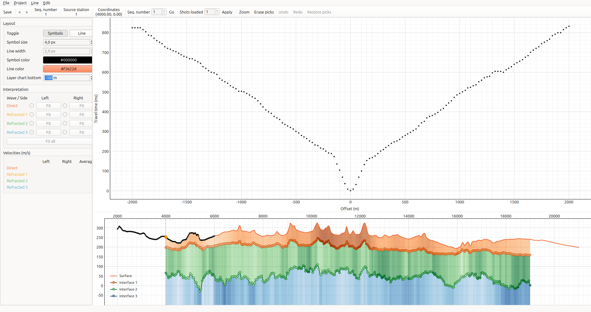

# refrac

A desktop application for **seismic refraction interpretation**. Load the first-break picks of a seismic line, step through the shots, and draw straight lines over each travel-time curve: the direct wave and up to three refracted arrivals, on both sides of the shot. refrac derives the layer velocities and thicknesses from those lines and plots the resulting subsurface interfaces.

## Download

The current version is **1.3** ([what's new](https://github.com/cadu-sg/refrac/releases/tag/v1.3)).

<p>
  <a href="https://github.com/cadu-sg/refrac/releases/latest/download/refrac-windows-setup.exe"></a>
  &nbsp;
  <a href="https://github.com/cadu-sg/refrac/releases/latest/download/refrac-linux-x86_64.AppImage"></a>
</p>

- **Windows:** [refrac-windows-setup.exe](https://github.com/cadu-sg/refrac/releases/latest/download/refrac-windows-setup.exe) (about 50 MB), for Windows 10 or 11, 64-bit.
- **Linux:** [refrac-linux-x86_64.AppImage](https://github.com/cadu-sg/refrac/releases/latest/download/refrac-linux-x86_64.AppImage) (about 60 MB), for 64-bit Ubuntu 22.04, Linux Mint 21, Debian 12, Fedora 36 or newer versions of them, or a distribution of similar age.

You don't need to install anything else: everything refrac needs comes inside the download. All versions are on the [Releases page](https://github.com/cadu-sg/refrac/releases).

## Installing on Windows

1. Click **Download for Windows** above.
2. Open the downloaded file, `refrac-windows-setup.exe`. It's usually in your **Downloads** folder, and your browser shows it at the end of the download.
3. Windows may warn you about the file, because refrac is new and doesn't come from a well-known publisher. The warnings look like this:
   - The browser says the file **"isn't commonly downloaded"**. In Microsoft Edge, click **⋯** next to the message, then **Keep**, then **Show more** and **Keep anyway**.
   - A blue window says **"Windows protected your PC"**. Click **More info**, then **Run anyway**.
4. Follow the installer: click **Next** and **Install**. It doesn't ask for an administrator password.
5. At the end, leave **Launch refrac** checked and click **Finish**.

From now on, start refrac from the **Start menu** or from the **refrac** icon on your desktop.

## Installing on Linux

refrac for Linux is a single file, `refrac-linux-x86_64.AppImage`: the file *is* the program. You can either keep it in a folder and run it from there, or install an AppImage management tool that adds it to your system's applications menu.

### Run AppImage directly (most straightforward)

1. Click **Download for Linux** above.
2. Move the downloaded file, `refrac-linux-x86_64.AppImage`, to a folder where you'll keep it, such as your home folder.
3. Allow the file to run as a program, once. Right-click it, choose **Properties**, open the **Permissions** tab if there is one, and turn on the option called **Executable as Program** or **Allow executing file as program**, depending on your system. (If you prefer the terminal: `chmod +x refrac-linux-x86_64.AppImage`.)
4. Double-click the file to start refrac.

### With an AppImage management tool (adds refrac to the applications menu)

An AppImage management tool keeps AppImages in one place and gives them an entry in the applications menu, with their icons. Two work well with refrac; pick the one that's easier to install on your computer:

- **[Gear Lever](https://gearlever.mijorus.it/)** is a Flatpak app from the Flathub repository, so it's the easier choice if your distribution comes with Flatpak and Flathub already set up, as Linux Mint does. [Set up Flathub](https://flathub.org/en/setup) tells you whether yours does.
- **[AppManager](https://github.com/kem-a/AppManager)** is itself an AppImage, so it needs neither Flatpak nor an administrator password. Choose it if you can't install Flatpak apps: on Ubuntu and Debian, Flatpak isn't installed by default, and installing it needs `sudo`.

#### Gear Lever

1. Go to the [Gear Lever page on the Flathub website](https://flathub.org/en/apps/it.mijorus.gearlever) and click **Install**. (If you prefer the terminal: `flatpak install -y it.mijorus.gearlever`.)
2. Click **Download for Linux** above.
3. Open Gear Lever and drag the downloaded file into its window.
4. Click **Unlock** if Gear Lever asks, then **Move to the app menu**.

#### AppManager

1. Download the AppManager AppImage from its [releases](https://github.com/kem-a/AppManager/releases/latest), allow it to run as in step 3 of [Run AppImage directly](#run-appimage-directly-most-straightforward), and double-click it to install AppManager.
2. Click **Download for Linux** above.
3. Double-click the downloaded refrac file. AppManager opens a window where you drag refrac to install it.

From now on, start refrac from the applications menu.

## Getting started

<p align="center"></p>

This walkthrough uses the example data, a synthetic seismic line, so you can try refrac before using picks of your own.

1. Download [example_picks_offset_2000m.zip](https://github.com/cadu-sg/refrac/releases/download/example-data/example_picks_offset_2000m.zip) (about 0.6 MB).
2. Unzip it to get the picks file, `example_picks_offset_2000m.csv`. On Windows, right-click the downloaded file and choose **Extract All...**. On Linux, right-click it and choose **Extract Here** (the wording depends on your system), or run `unzip example_picks_offset_2000m.zip` in a terminal.
3. In refrac, choose **Project → New Project...** and pick a folder for the project. A project holds any number of seismic lines.
4. Choose **Line → New Line...** and type a title for the line. Click the **...** button next to **Picks File**, select `example_picks_offset_2000m.csv`, and click **OK**. refrac shows the first shot: its travel-time curve at the top, and the surface of the line at the bottom, with the shot marked.
5. Draw lines over the travel-time curve: the direct wave, then up to three refracted arrivals, on each side of the shot. Select a line in the **Interpretation** box, then click its end points on the chart (the direct wave starts at the shot, so it needs one click). Lines are drawn from the shot outwards, so **Refracted 1** becomes available once **Direct** is drawn on that side. Once a line is drawn, its **Fit** button adjusts it to the picks between its intersections with the neighbouring lines (**Fit all** does every line), and right-clicking erases the nearest end point so you can place it again. The **Velocities** box updates as you draw.
6. Click **Save** (or press **S**). The interfaces below the shot appear at the bottom.
7. Go to the next shot with **>** (or **→**), or click the bottom chart to jump to the shot nearest to where you click. A new shot starts with the lines saved for the nearest shot before it, so you often only need to adjust them.
8. When you've interpreted the shots you want, **Line → Export Interpretation...** writes a CSV file with one row per saved shot. Its columns are `FFID`, `SOU_SLOC`, `SOU_X`, `SOU_Y` and `SOU_ELEV` for the source, `V1` for the direct-wave velocity, `V2` to `V4` for the refracted-arrival velocities (m/s) and `Z1` to `Z3` for the elevations of the interfaces. A velocity averages the slowness of both sides of the shot, or uses the only side drawn. Values that can't be computed are left empty.

Your work is saved inside the project folder. Next time, use **Project → Open Project...** and **Line → Open Line...** to continue. To interpret your own picks, create a line from your picks file in step 4; see [Picks file format](#picks-file-format).

### Example data

The [Example data](https://github.com/cadu-sg/refrac/releases/tag/example-data) page of the releases has two picks files of the same synthetic seismic line, 301 shots 50 m apart with receivers every 25 m:

- [example_picks_offset_2000m.zip](https://github.com/cadu-sg/refrac/releases/download/example-data/example_picks_offset_2000m.zip): the receivers go up to 2000 m from each shot. Used in [Getting started](#getting-started).
- [example_picks_offset_4000m.zip](https://github.com/cadu-sg/refrac/releases/download/example-data/example_picks_offset_4000m.zip): the receivers go up to 4000 m from each shot, so the refracted arrivals reach farther.

### Picks file format

A text file with one first-break pick per row. The first line is a header naming the columns, which may appear in any order:

| Column | Meaning |
|---|---|
| `FFID` | Shot sequential number |
| `SOU_SLOC` | Source station number |
| `SRF_SLOC` | Receiver station number, or channel number within the shot |
| `FB_PICK` | Travel time (ms) |
| `SOU_X`, `SOU_Y` | Source coordinates |
| `REC_X`, `REC_Y` | Receiver coordinates |
| `REC_ELEV` | Receiver elevation |
| `OFFSET` | Signed source–receiver offset (m), negative for receivers at a smaller X than the source |
| `CDP` | Station nearest to the source–receiver midpoint |
| `SOU_ELEV` | Source elevation (optional) |

- Columns are separated by spaces, tabs or semicolons.
- Numbers may use a decimal point or a decimal comma, as long as the whole file uses the same one.
- Receivers are placed by their coordinates, so `SRF_SLOC` may number the channels of each shot instead of the stations of the line.
- Without a `SOU_ELEV` column, a source takes the elevation of the receiver at its position or, between receivers, an elevation interpolated from the two nearest.
- A shot is a run of consecutive rows with the same `FFID`.
- When creating a line, refrac warns about a receiver position given more than one elevation, and about offsets whose sign is mostly opposite to `REC_X` − `SOU_X`.

For an example, see the [example data](#example-data), which uses semicolons and decimal commas.

## Updating

Download refrac again with the buttons above.

- **Windows:** run the new installer. It replaces the old version.
- **Linux, running the AppImage directly:** replace the old AppImage file with the new one, and allow it to run as in step 3 of [Run AppImage directly](#run-appimage-directly-most-straightforward).
- **Linux with Gear Lever or AppManager:** install the new file the same way, which replaces the old version. To let either tool look for updates itself, give it this address as refrac's update URL: `https://github.com/cadu-sg/refrac/releases/latest/download/refrac-linux-x86_64.AppImage`.

Your projects are kept in their own folders, so updating doesn't touch them.

## Uninstalling

- **Windows:** open **Settings → Apps → Installed apps**, find **refrac**, and choose **Uninstall**.
- **Linux, running the AppImage directly:** delete the AppImage file.
- **Linux with Gear Lever or AppManager:** open the tool, select **refrac** and remove it.

Your projects stay where you saved them. Delete their folders too if you don't need them anymore.

## Troubleshooting

- **Windows: the antivirus removed or blocked the file.** Some antivirus programs distrust new programs that aren't from a well-known publisher. Restore the file from the antivirus's quarantine, or ask whoever manages your computer to allow it.
- **Linux: nothing happens when I double-click the file.** The file isn't allowed to run yet; see step 3 of [Run AppImage directly](#run-appimage-directly-most-straightforward). If it still doesn't start, open a terminal in the file's folder and run `./refrac-linux-x86_64.AppImage` to see the error message.
- **Linux: the error mentions FUSE or `fusermount`.** Install FUSE (on Ubuntu or Debian: `sudo apt install fuse3`), or start refrac with `./refrac-linux-x86_64.AppImage --appimage-extract-and-run`.
- **Something else went wrong?** [Open an issue](https://github.com/cadu-sg/refrac/issues) describing what you did and what happened.

## Running from source

On macOS, or to run the latest development version, run refrac with your own Python 3.10 or newer (from [python.org](https://www.python.org/downloads/) or [Anaconda](https://www.anaconda.com/download)). In a terminal:

```
python3 -m venv refrac-env
source refrac-env/bin/activate          # Windows: refrac-env\Scripts\activate
pip install git+https://github.com/cadu-sg/refrac.git
refrac
```

This needs [Git](https://git-scm.com/downloads). Next time, activate the environment again before running `refrac`. On Linux, Qt also needs a system library to open windows: `sudo apt install libxcb-cursor0` on Ubuntu or Debian, `sudo dnf install xcb-util-cursor` on Fedora.

### Development

Developers can use [mise](https://mise.jdx.dev/) and [uv](https://docs.astral.sh/uv/):

```
git clone https://github.com/cadu-sg/refrac.git
cd refrac
mise install    # Python and uv
uv sync         # create .venv with the dependencies
uv run refrac   # run the app
uv run pytest   # run the tests
```

The Windows installer and the Linux AppImage are built by GitHub Actions; see `packaging/` and [CLAUDE.md](CLAUDE.md).
